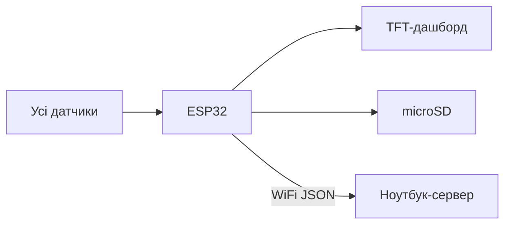

# Physik — склад проєкту

**Один контролер** на весь пристрій (датчики + дисплей + SD + WiFi).  
Бюджет купівлі заліза ≤ **4500 грн**.  
**Сервер** — окремий ноутбук (не входить у цей бюджет).

## Контролер

Використовуємо **вже наявний звичайний ESP32** (DevKit / WROOM-32) — вистачає WiFi, GPIO, ADC, SPI/I2C.  
**S3 не купуємо.**

Типові назви плати: `ESP32-DevKitC`, `ESP32-WROOM-32 DevKit`, `NodeMCU-32S` — будь-який нормальний DevKit з виведеними GPIO.

## Архітектура

## Що докупити (контролер уже є)

| Модуль | Навіщо |
|--------|--------|
| TFT ILI9341 320×240 (2.8″ або 3.5″) | кольоровий дашборд |
| BME280 | клімат кабіни: T + RH + тиск |
| MQ-135 | груба якість повітря / гази |
| MAX30102 | пульс + SpO2 |
| AD8232 + електроди/ремінь | ЕКГ |
| MLX90614 | температура без контакту |
| MPU6050 | активність / сесії руху (див. про 0g нижче) |
| HX711 + тензодатчик | хват і маса (м’язи / вага) |
| microSD + карта | лог за добу |
| Buzzer + LED | сповіщення air / пороги |
| Кнопки mood / MODE / CAL / SYNC | введення |
| Корпус + powerbank | живлення |

Датчик радіації (CAJOE / RadSens) — **поки відкладено** (дорого); можна додати пізніше.

## MPU-6050 у невагомості

У MPU-6050 два сенсори:

| Сенсор | На Землі | У ~0g (орбіта / вільне падіння) |
|--------|----------|----------------------------------|
| **Акселерометр** | бачить гравітацію ≈9.8 → можна зрозуміти «де низ» / нахил | на чип «не тисне» g → \|a\|≈0 у спокої; **нахил відносно «низу» не визначити** |
| **Гіроскоп** | кутова швидкість | **працює так само** — повороти тіла/рук |

Що рахуємо в проєкті:
- **Рух / активність** — сплески прискорення, коли космонавт відштовхується, крутиться, робить вправу (`acc`, EMA активності, прапорець `low_act`).
- **Прапорець невагомості** — довго \|a\| < ~1 м/с² → `zg=1` (на Землі для демо крутимо плату).
- **Абсолютний напрямок («куди дивиться»)** — MPU-6050 **не дає** (немає магнітометра; у 0g немає вектора «вниз»). Для компаса потрібен MPU-9250 / BNO085 тощо — у BOM не закладаємо.

Висновок: модуль Ref для хакатону ок як **лічильник активності та сесій**, не як навігація/компас.

## Режими роботи

- **Фон:** BME280 (клімат), MQ-135 (повітря), MPU → `air_bad` / `low_act` + пищалка  
  (MQ-135 прогрівається 1–3 хв; поріг `air_bad` по ADC)  
- **Check:** HR, SpO2, ЕКГ, temp, вага, mood  
- **Exercise:** хват (HX711) + активність з MPU  
- **SD** jsonl → **WiFi POST** на ноутбук  
- **TFT:** STATUS + Heart / ECG / Heat / Strength / Mood / Move / Body / AIR  

FSR і радіація **поза поточною збіркою**. М’язи/кістки: хват + MPU.

`#define SIM_MODE 1` — демо без заліза.

## Орієнтир цін (₴), без ноутбука і без ESP32

Датчики + екран + SD + корпус ≈ **1900–2200**, стеля **4500**.

## Прошивка

- `Physik/station/sketch.ino` — одна прошивка під **звичайний ESP32**
