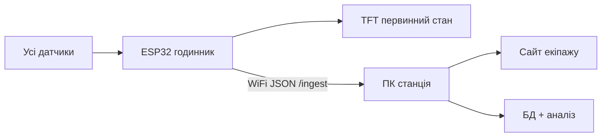

# Physik — склад проєкту

**Один контролер** на весь пристрій (датчики + дисплей + SD + WiFi).  
Бюджет купівлі заліза ≤ **4500 грн**.  
**Сервер** — окремий ноутбук (не входить у цей бюджет).

## Контролер

Використовуємо **вже наявний звичайний ESP32** (DevKit / WROOM-32) — вистачає WiFi, GPIO, ADC, SPI/I2C.  
**S3 не купуємо.**

Типові назви плати: `ESP32-DevKitC`, `ESP32-WROOM-32 DevKit`, `NodeMCU-32S` — будь-який нормальний DevKit з виведеними GPIO.

## Архітектура

**Станція = ПК** (сайт + бек + compute). **ESP32 = годинник/КПК** (датчики + TFT).  
Деталі: [`../ARCHITECTURE.md`](../ARCHITECTURE.md)

## Куплено (факт, 2026-11)

| Модуль | Статус | Примітка |
|--------|--------|----------|
| TFT SPI **1.8″ 128×160** v1.1 | ✅ | зазвичай **ST7735** (не ILI9341 2.8″) |
| microSD SPI | ✅ | лог |
| MAX30102 | ✅ | пульс + SpO2 |
| Датчик пульсу (окремий) | ✅ | аналог. HR (дубль/резерв до MAX30102) |
| MPU-**6500** | ✅ | IMU (замість 6050; I²C той самий підхід) |
| HX711 + вага | ✅ | хват / маса |
| BMP280 | ✅ | T + тиск (**без вологості**, на відміну від BME280) |
| MQ-135 (сітка-ковпак) | ✅ | якість повітря / `air_bad` |

## Ще докупити / опційно

| Модуль | Навіщо |
|--------|--------|
| AD8232 + електроди | ЕКГ |
| MLX90614 | температура без контакту |
| Buzzer + LED | сповіщення |
| Кнопки mood / MODE / CAL / SYNC | введення |
| Корпус + powerbank | живлення |
| microSD-карта (якщо не в комплекті) | лог |

Датчик радіації — **поки відкладено**.

## MPU-6500 у невагомості

У MPU-6500 (як і 6050) два сенсори:

| Сенсор | На Землі | У ~0g (орбіта / вільне падіння) |
|--------|----------|----------------------------------|
| **Акселерометр** | бачить гравітацію ≈9.8 → «де низ» / нахил | \|a\|≈0 у спокої; **нахил відносно «низу» не визначити** |
| **Гіроскоп** | кутова швидкість | **працює так само** |

Що рахуємо:
- **Рух / активність** — сплески `acc`, EMA, прапорець `low_act`.
- **Прапорець невагомості** — довго \|a\| < ~1 м/с² → `zg=1`.
- **Компас / абсолютний напрямок** — MPU-6500 **не дає** (немає магнітометра).

## Режими роботи

- **Фон:** BMP280 (T/тиск), MPU → `low_act`; MQ-135 → `air_bad` (коли з’явиться)  
- **Check:** HR (MAX30102 / pulse), SpO2, вага (HX711), mood  
- **Exercise:** хват (HX711) + активність MPU  
- **SD** jsonl → **WiFi POST** на ноутбук  
- **TFT 1.8″ 128×160:** компактний UI (крупні плитки / сторінки)  

FSR і радіація **поза збіркою**. М’язи/кістки: хват + MPU.

`#define SIM_MODE 1` — демо без заліза.

## Орієнтир цін (₴), без ноутбука і без ESP32

Датчики + екран + SD + корпус ≈ **1900–2200**, стеля **4500**.

## Прошивка годинника

- **`Physik/watch/pulsar_watch/pulsar_watch.ino`** — ESP32 (годинник)
- Станція на ПК: `site/prototype/` (`npm run compute|api|web`)
