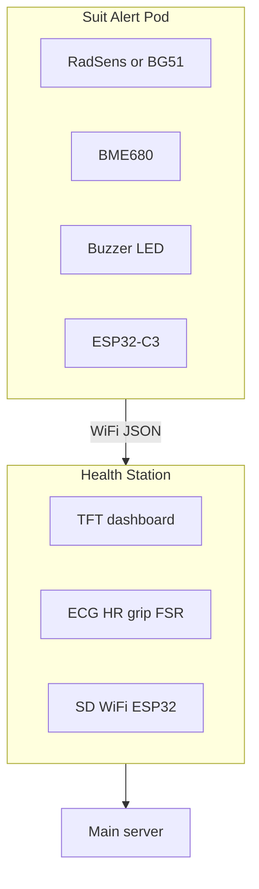

# Physik — финальные решения (обдумано)

NASA Space Apps Hackathon 2026. Бюджет железа **≤ 4500 грн**.

## Жёсткие решения (без развилок)

1. **Бюджет ≤ 4500 грн.**
2. **Два устройства, две прошивки** (не один шлейф):
   - `Physik/suit_alert/` — ESP32-C3 + RadSens/BG51 + BME680 + buzzer
   - `Physik/station/` — ESP32 DevKit + TFT + медицина + SD + WiFi на сервер
3. **Связь:** Suit Alert шлёт UDP/HTTP JSON на станцию по WiFi; станция пишет SD и при online шлёт на главный сервер.
4. **Экран станции:** код под **ILI9341 320×240** (Adafruit), в BOM можно купить 2.8″ или 3.5″ ILI9341-совместимый; плиточный UI крупный «для ребёнка».
5. **`#define SIM_MODE 1`** в обеих прошивках — демо без железа (синтетика rad/air/vitals).
6. Старую папку `SCHEME/` не используем (Wokwi-прототип снят с основного трека).
7. ЭКГ/пульс/хват/FSR — только сессии; Suit Alert — без контакта с кожей.

## Зачем так

- Компактный под реально лезет в макет скафандра; трубка Гейгера — нет.
- BME680 закрывает «загрязнение воздуха» без вонючих MQ.
- Отдельный C3 = под работает, даже если станция выключена (пищалка).
- SIM_MODE нужен хакатону до покупки деталей.

## Два блока системы



### Suit Alert Pod (компакт, скафандр)

- **RadSens / BG51** — скачок фона → `rad_leak` (утечка радиации в объём)
- **BME680** — VOC/gas → `air_bad` (загрязнение воздуха)
- **ESP32-C3 mini** + пищалка + LED
- Опционально MPU6050 на том же поде
- Без MQ-датчиков и без большой трубки Гейгера

### Health Station

- ESP32 DevKit, TFT, MAX30102, AD8232 (сессия), MLX90614, HX711 grip/weight, 2×FSR, microSD, mood-кнопки
- Плитки RAD / AIR с телеметрии Suit Alert

## Edge-алерты Suit Alert

- `rad_leak` — μSv/h или CPM выше baseline×k или абсолютного порога
- `air_bad` — gas resistance / VOC index хуже порога или резкий рост
- LED + buzzer локально; JSON на станцию раз в 2 с

## Станция

- Фоном: ждёт Suit Alert + (если есть) MPU
- Check: HR/SpO2, ECG RMS, temp, weight, mood
- Exercise: grip, FSR heel/toe, load_dose
- SD jsonl каждые 10 с; upload `POST /api/v1/ingest` при WiFi
- TFT: STATUS + плитки Heart/ECG/Heat/Strength/Feet/Mood/Move/Body/RAD/AIR

## Ориентир цен (₴) ≤ 4500

Suit Alert: ESP32-C3 150–250 · RadSens 300–500 · BME680 120–180 · buzzer/LED/корпус 80–150 · powerbank mini 100–180

Станция: ESP32 180–250 · TFT 450–700 · MAX30102 100–160 · AD8232 180–280 · MLX90614 80–140 · MPU 50–80 · HX711 120–200 · FSR×2 120–220 · SD 110–170 · корпус/кнопки 200–350 · powerbank 100–200

**Итого ориентир ~2500–4000 грн**, потолок 4500.

## Файлы к созданию (следующие шаги)

```
Physik/
  README.md
  BOM.md
  PINOUT.md
  COMFORT.md
  RISKS.md
  SERVER.md
  suit_alert/sketch.ino
  station/sketch.ino
  PLAN.md          ← этот документ
```
